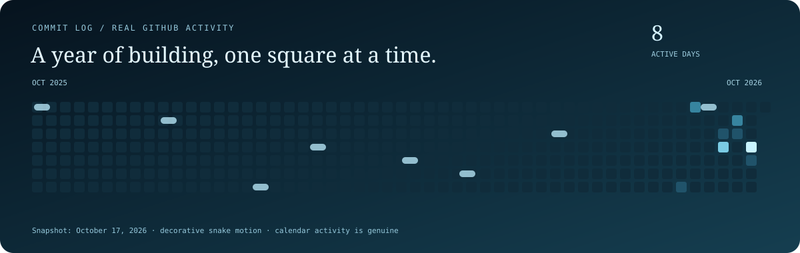

  

  <a href="https://github.com/sujalrao061">GitHub</a> ·
  <a href="https://www.linkedin.com/in/sujal-rao-709069432">LinkedIn</a> ·
  <a href="#selected-projects">Selected projects</a>

  

## Hello, I'm Sujal

I build practical web applications and explore cybersecurity through projects. My work spans workforce coordination, privacy-aware investigations, and GPU memory experiments—turning technical problems into tools people can inspect and use.

## Selected projects

### Headroom
**GPU memory experiments with independent correctness checks.**

A PyTorch proof of concept that evaluates bounded memory-repair strategies against explicit output contracts. A Next.js workbench makes recorded GPU measurements and validation evidence inspectable.

`Python` · `PyTorch` · `Next.js` · `TypeScript`

[Explore the demo](https://headroom-beta-tan.vercel.app) · [Read the source](https://github.com/sujalrao061/headroom)

### TalentReadiness
**Find suitable coverage when a team member is unavailable.**

A workforce-readiness platform that compares skills, availability, and workload to recommend replacements, explain the match, and support employee approval.

`React` · `TypeScript` · `FastAPI` · `SQLAlchemy` · `SQLite`

[Explore the demo](https://talentreadiness.vercel.app) · [Read the source](https://github.com/sujalrao061/talentreadiness)

### TraceGuard
**Investigate security signals with evidence and privacy in view.**

A cybersecurity portfolio lab using synthetic identity events, transparent detection rules, evidence-linked briefs, and redacted reports. The hosted experience is a browser-only demonstration.

`JavaScript` · `HTML / CSS` · `Python` · `FastAPI` · `SQLite`

[Explore the demo](https://traceguard-kappa.vercel.app) · [Read the source](https://github.com/sujalrao061/traceguard)

## Toolkit

| Area | Technologies used in my projects |
| :--- | :--- |
| Languages | Python, TypeScript, JavaScript, HTML, CSS |
| Interfaces | React, Next.js, Vite, Tailwind CSS |
| APIs & data | FastAPI, SQLAlchemy, SQLite |
| ML & compute | PyTorch, CUDA memory measurement |
| Delivery | Docker, Vercel, Render |

## Contribution activity

This is a dated snapshot of GitHub's contribution activity levels, recolored in glacier blue. [View current activity on GitHub](https://github.com/sujalrao061?tab=overview).

