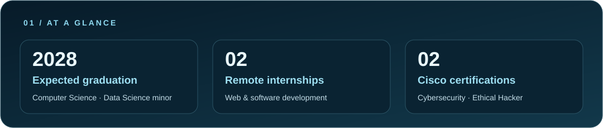
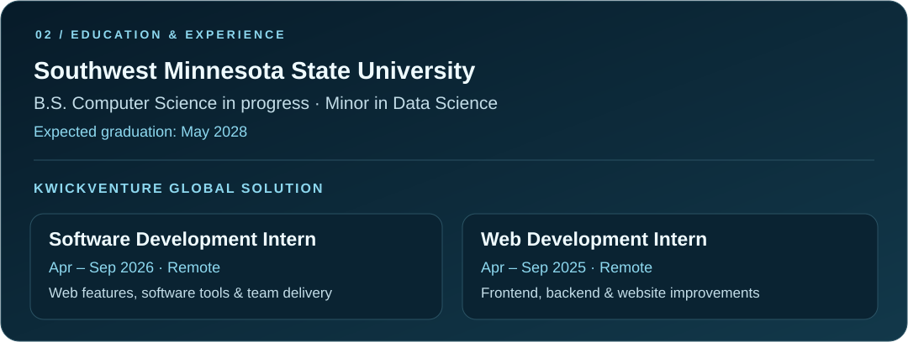
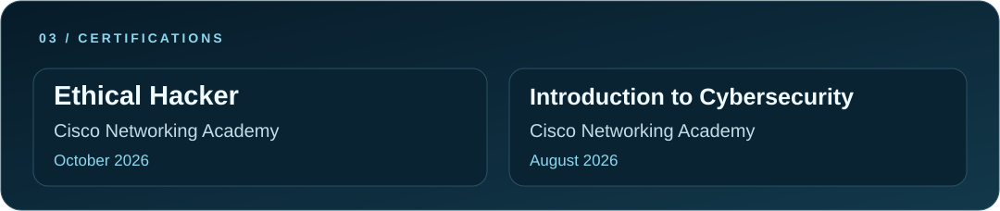
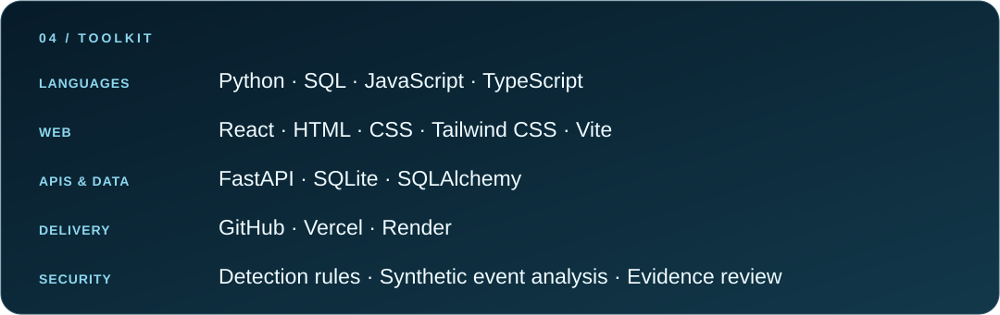

  

  

  
  

### Hello, I'm Sujal

I'm a Computer Science junior with a Data Science minor at Southwest Minnesota State University. I build web applications and cybersecurity portfolio projects, with two remote internships in web and software development.

**Seeking Summer 2027 IT opportunities** involving Python, JavaScript/TypeScript, APIs, and deployment.

## Education & experience

## Certifications

## Selected projects

### 01 / Headroom
**GPU memory experiments with independent correctness checks.**

A PyTorch proof of concept that evaluates bounded memory-repair strategies against explicit output contracts. The Next.js workbench presents recorded GPU measurements and validation evidence.

`Python` · `PyTorch` · `Next.js` · `TypeScript`

[Live demo ↗](https://headroom-beta-tan.vercel.app) · [Source code ↗](https://github.com/sujalrao061/headroom)

---

### 02 / TalentReadiness
**Find suitable coverage when a team member is unavailable.**

Built solo for Southwest MN Hacks in September 2026. Matches employees against skills, availability, workload, and project fit, with workflows for employees and managers.

`React` · `TypeScript` · `FastAPI` · `SQLAlchemy` · `SQLite`

[Live demo ↗](https://talentreadiness.vercel.app) · [Source code ↗](https://github.com/sujalrao061/talentreadiness)

---

### 03 / TraceGuard
**Investigate security signals through linked evidence.**

A portfolio lab with three detection rules for synthetic identity events. The hosted JavaScript demo and the separate Python/FastAPI API demonstrate investigation workflows without customer data or live company-system access.

`JavaScript` · `HTML / CSS` · `Python` · `FastAPI` · `SQLite`

[Live demo ↗](https://traceguard-kappa.vercel.app) · [Source code ↗](https://github.com/sujalrao061/traceguard)

### Academic work

- **Income Tax Comparison Tool:** Python, SQL, and React coursework comparing estimated state income taxes across all 50 U.S. states.
- **KnowYourFinance:** DevOps & QA Lead for a four-person academic budgeting-app proposal. Planning unit and integration testing and deployment; currently at proposal stage.

## Technical toolkit

## Contribution activity

Actual GitHub contribution activity levels, recolored in glacier blue. Snapshot captured October 17, 2026. [View current activity](https://github.com/sujalrao061?tab=overview).

<b>Let's build something useful.</b> 
<a href="https://www.linkedin.com/in/sujal-rao-709069432">Connect on LinkedIn</a> · <a href="https://github.com/sujalrao061?tab=repositories">Explore my work</a>

